# bob tudo

utilitário do windows para disco, sistema e aplicativos. é o irmão do [bob baixa](https://github.com/goszc/bob-baixa): a mesma janela, os mesmos quatro temas, e um instalador que é só executar.

a interface é em português, toda em minúsculas. o tema segue o windows e também pode ser claro, escuro, vidro claro ou vidro escuro.

## instalar

baixe `bob-tudo-setup.exe` na [página de releases](https://github.com/goszc/bob-tudo/releases). o instalador é por usuário, em `%LOCALAPPDATA%\bob tudo`, com atalho no menu iniciar e, se você marcar, na área de trabalho.

o windows pode mostrar o smartscreen na primeira vez. o instalador não tem assinatura de código. em “mais informações”, escolha executar mesmo assim. o webview2 já vem no windows 11; no windows 10, instale o runtime da microsoft se a janela não abrir.

o catálogo junta winget, github, scoop e chocolatey. em ajustes dá para instalar o gerenciador que faltar: winget pelo app installer, scoop na sua conta, chocolatey com permissão de administrador.

## o que faz

- mapa do disco de qualquer pasta, com blocos por tipo, busca e exclusão para a lixeira.
- limpeza de temporários, caches de navegador, lixeira, download do windows update, dism `StartComponentCleanup` (sem `/ResetBase`), logs, miniaturas e despejos. o tamanho aparece antes. temporários e caches são apagados de vez; o mapa e os duplicados vão para a lixeira.
- duplicados pelo conteúdo (tamanho, depois os primeiros 64 kb, depois blake3) e fotos parecidas na mesma pasta.
- saúde do ssd e do hd pelo smart do windows, com smartctl se estiver no caminho, em `C:\Program Files\smartmontools\bin` ou em `%LOCALAPPDATA%\bob tudo`.
- inicialização: registro, pastas, tarefas de logon e serviços que não são do windows.
- monitor ao vivo de cpu, memória, disco, placa, rede, temperatura e processos.
- privacidade com interruptores reversíveis. ligado significa proteção ligada.
- ponto de restauração e diário do que o programa mudou, com desfazer.
- catálogo único (winget, github, scoop e chocolatey), com readme, versões, favoritos, coleções e instalação em lote. atualizações e desinstalação continuam.

## administrador

o programa não pede administrador para abrir. a instalação também é do usuário atual. só a ação que precisa (registro da máquina, serviço, tarefa, dism, windows update, lixeira do sistema, ponto de restauração) abre a janela do windows. se você recusar, o que for do seu usuário segue, com um aviso; o que for da máquina para.

a primeira mudança de sistema em cerca de dez minutos cria um ponto de restauração. o windows normalmente limita isso a um por dia; o script elevado zera `SystemRestorePointCreationFrequency` só durante a chamada e devolve o valor anterior. a restauração do sistema precisa estar ligada no windows.

## atualizar

ao abrir, o programa olha

`https://github.com/goszc/bob-tudo/releases/latest/download/latest.json`

baixa o instalador, confere a assinatura e oferece reiniciar. a chave pública está no programa. a chave privada fica com quem publica, no segredo `TAURI_SIGNING_PRIVATE_KEY` do repositório `goszc/bob-tudo` (sem senha). uma tag `v*` publica o instalador e o `latest.json`.

## desenvolver

```bash
npm install
npm run dev
```

a interface sobe em `http://127.0.0.1:47331`. no navegador os dados são de demonstração e nada é apagado.

no windows, com o rust estável e o nsis:

```bash
npm run tauri build -- --no-bundle
makensis /DEXE=src-tauri\target\release\bob-tudo.exe /DICON=src-tauri\icons\icon.ico packaging\bob-tudo.nsi
```

o `makensis` do chocolatey fica em `C:\Program Files (x86)\NSIS` e pode não estar no path.

num linux, o executável do windows sai com o [cargo-xwin](https://github.com/rust-cross/cargo-xwin):

```bash
cargo xwin build -p bob-tudo --release --target x86_64-pc-windows-msvc
makensis -DEXE=src-tauri/target/x86_64-pc-windows-msvc/release/bob-tudo.exe -DICON=src-tauri/icons/icon.ico packaging/bob-tudo.nsi
```

os testes da lógica que não depende do windows:

```bash
cargo test -p bob-core
```

## temas

| | claro | escuro | vidro claro | vidro escuro |
| --- | --- | --- | --- | --- |
| mapa | 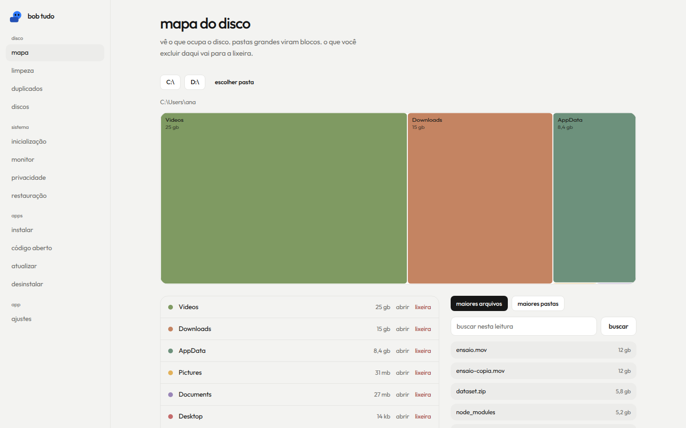 | 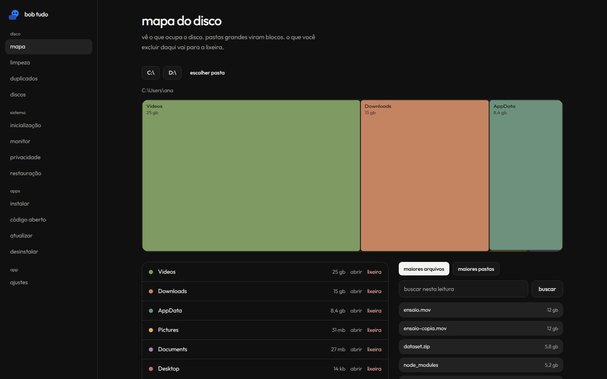 | 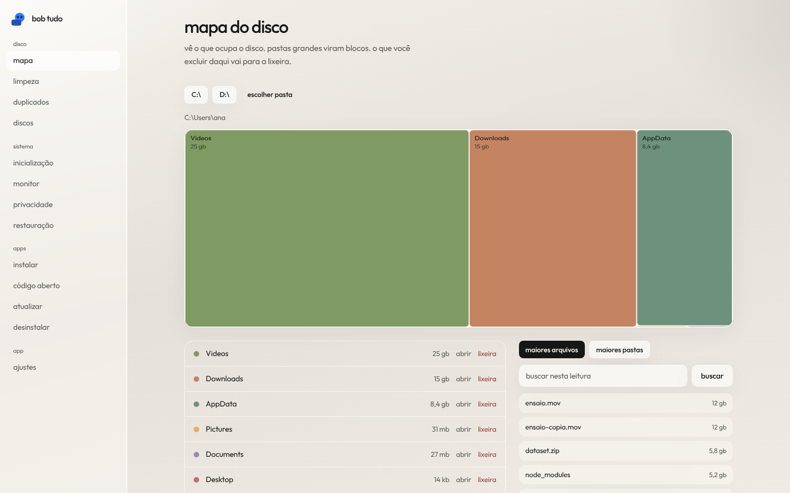 | 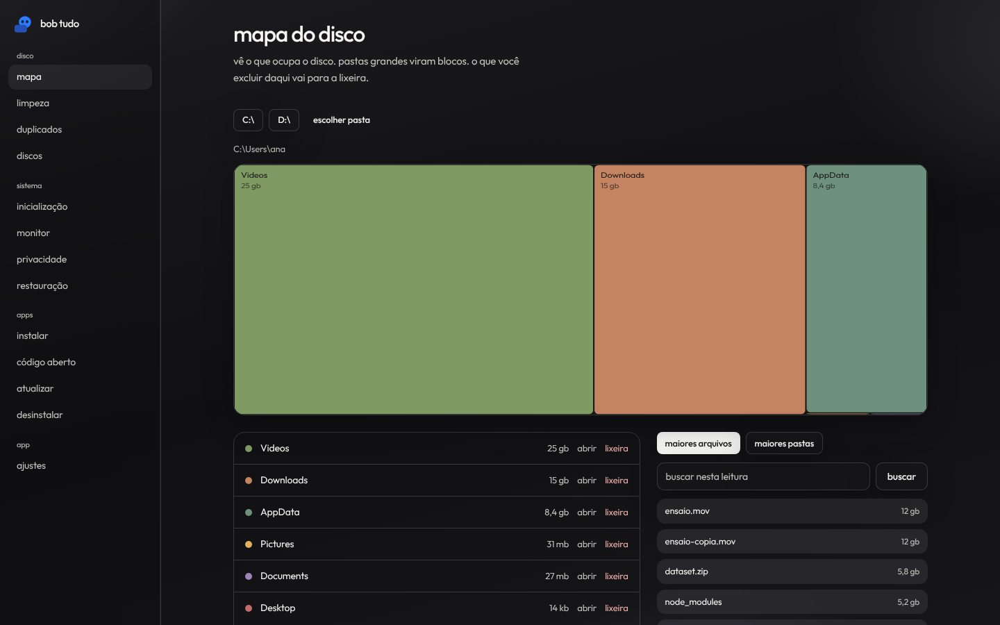 |
| limpeza | 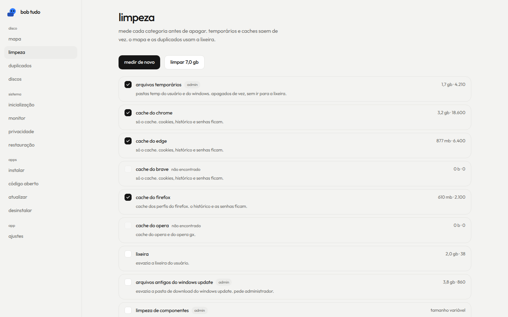 | 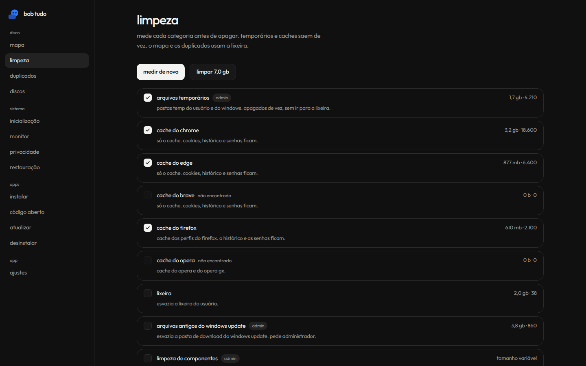 | 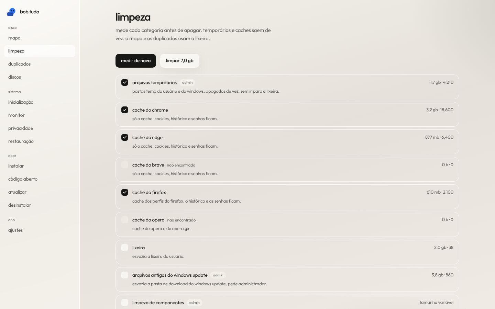 | 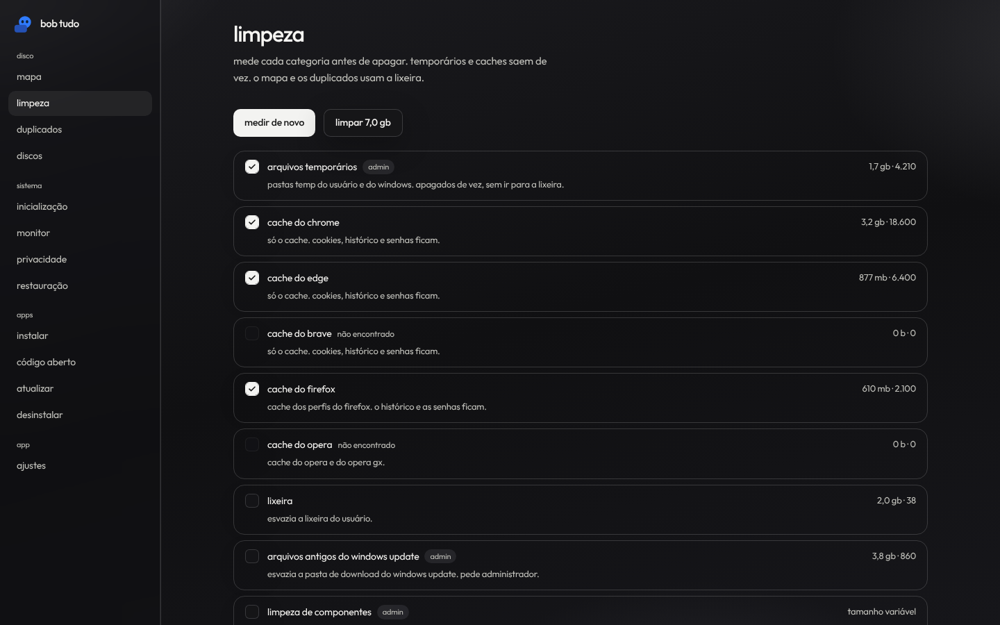 |
| monitor | 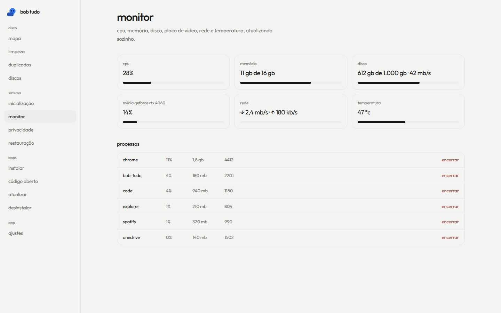 | 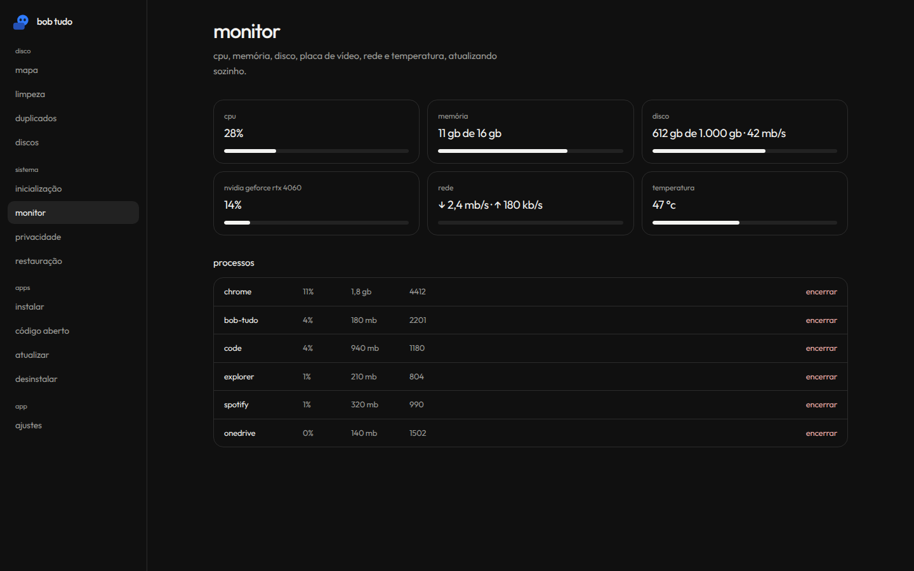 | 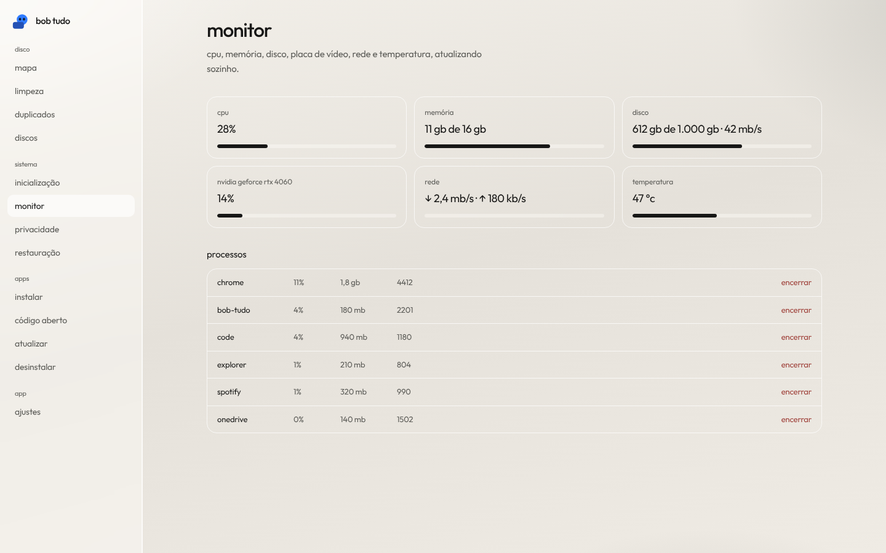 | 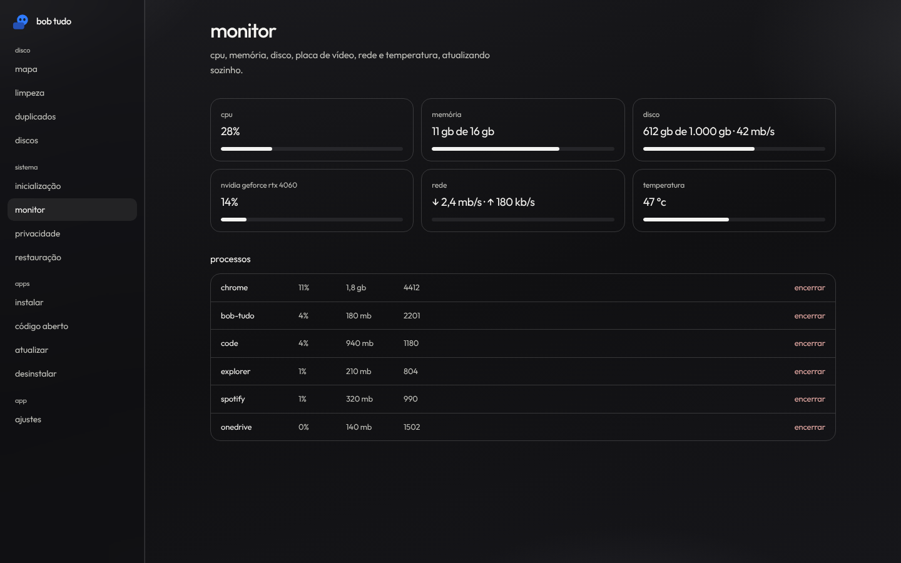 |
| ajustes | 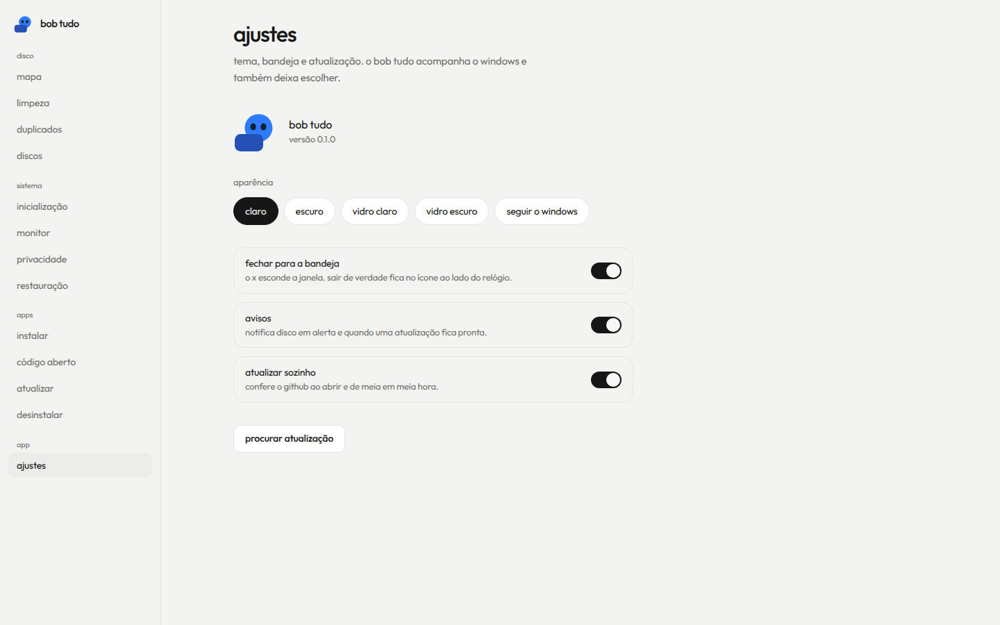 | 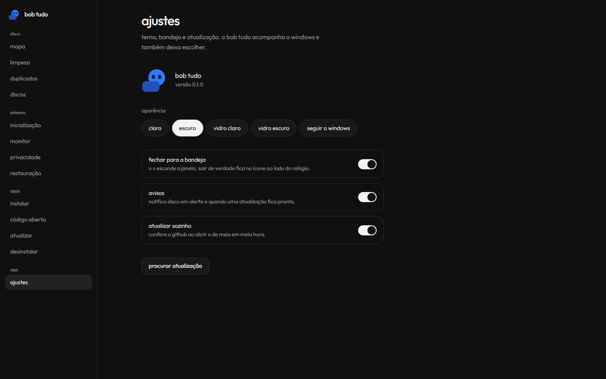 | 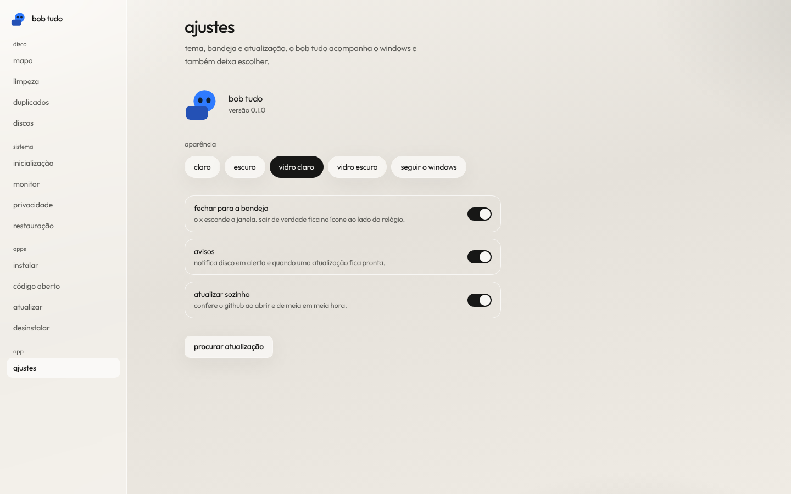 | 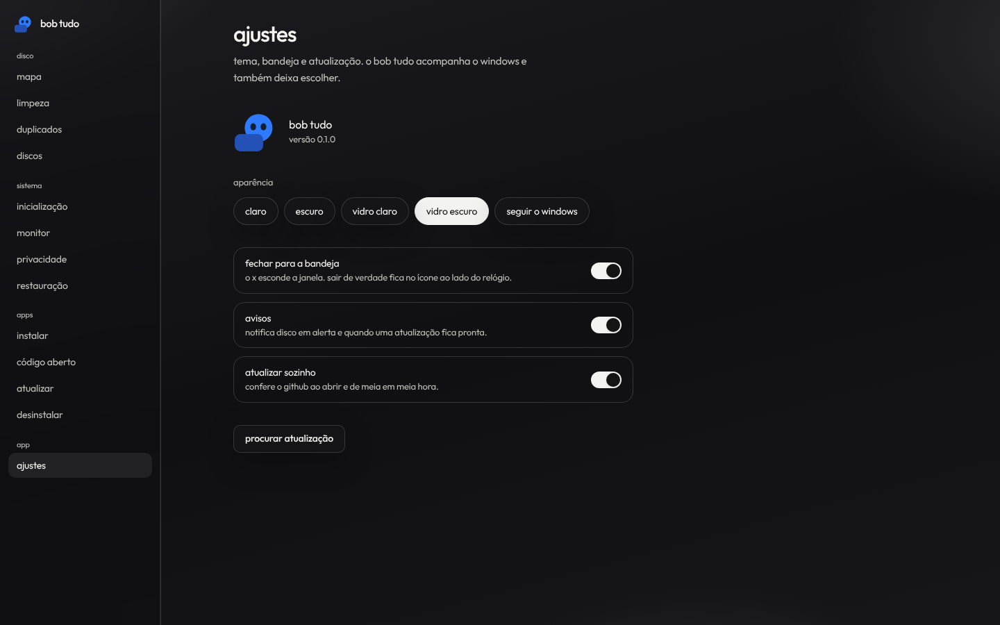 |

as outras telas estão em `docs/screenshots`.

## limites

isto foi desenvolvido e testado fora de um windows de verdade. o mapa não lê a mft: uma leitura direta do volume pediria administrador e acesso bruto, então a varredura é pelos arquivos. caches não vão para a lixeira de propósito. o copilot só some o botão. no windows home, telemetria `0` pode ser tratada como `1`. serviços dentro do system32 não são mexidos. processos filhos nascem sem janela de console.
